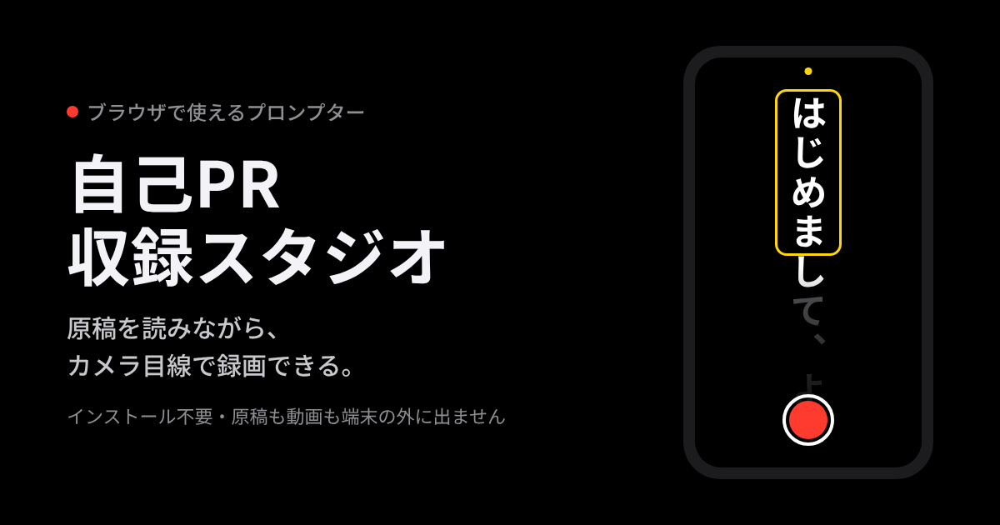

# 自己PR収録スタジオ

原稿を読みながら、カメラ目線で自己PR動画を録画できるブラウザ用のプロンプターです。
インストールは不要で、URLを開くだけで使えます。

**https://rinta1015.github.io/pr-studio/**

## できること

- 原稿を一定の速さで流しながら、カメラで録画する
- 横書き / 縦書き の切り替え
  - 縦書きは、黄色い枠に入った3〜5文字だけを読む形式。目線をほとんど動かさずに読めます
- 横動画（16:9）/ 縦動画（9:16）の切り替え
- 制限時間と、原稿を流す時間を秒単位で指定
- カメラの位置（上 / 左 / 右）に合わせて、読む場所をカメラ側に寄せる
- 撮ったテイクをその場で見返して、端末に保存

## 使い方

1. URLを開き、カメラとマイクの使用を許可する
2. 「原稿」に原稿を貼り付ける
3. 制限時間、流す時間、カメラの位置を設定する
4. 「練習」で読む速さを確かめる
5. 「録画」を押す。3秒のカウントのあとに録画が始まり、原稿が流れます
6. 撮ったテイクを見返して「保存」

PCではキーボードでも操作できます（Space：録画 / P：練習 / ↑↓：位置合わせ）。

iPhone・iPadでは、共有ボタンから「ホーム画面に追加」すると、アプリのように起動できます。

## 対応環境

| 端末 | ブラウザ |
| --- | --- |
| PC | Chrome / Edge |
| iPhone / iPad | Safari |
| Android | Chrome |

保存される動画の形式はブラウザによって異なります（MP4 または WebM）。

## データの扱い

- 原稿は、使っている端末のブラウザの中にだけ保存されます
- 録画した動画は、保存ボタンを押したときに端末へ保存されるだけで、どこにもアップロードされません
- 通信はページとフォント（Google Fonts）の読み込みだけです。アクセス解析なども入れていません

## ファイル構成

すべての機能は `index.html` 1ファイルで動きます。ビルドや外部ライブラリは使っていません（フォントのみGoogle Fontsから読み込み）。
